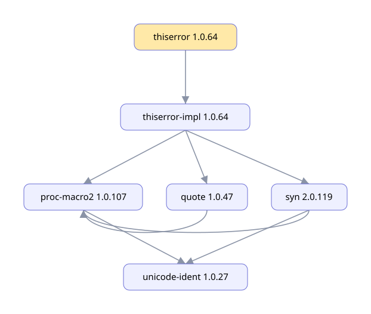
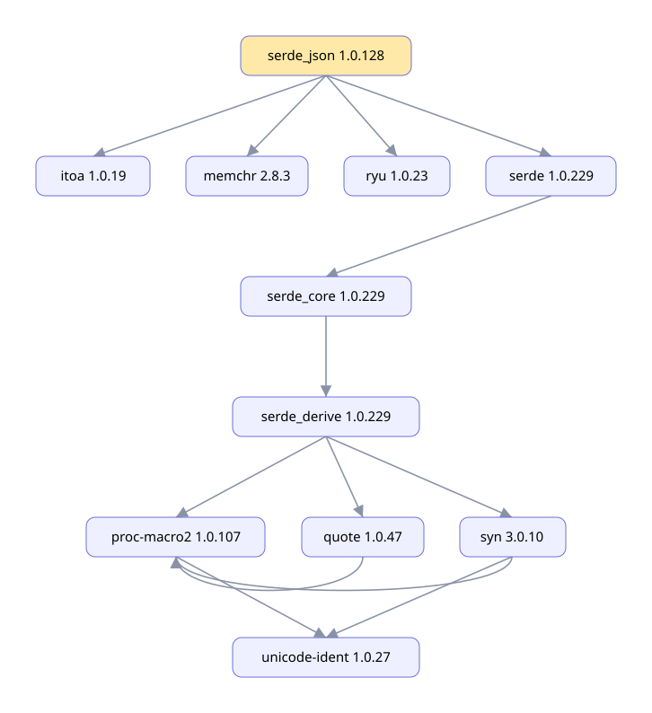
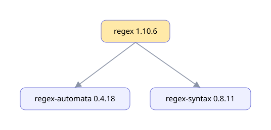
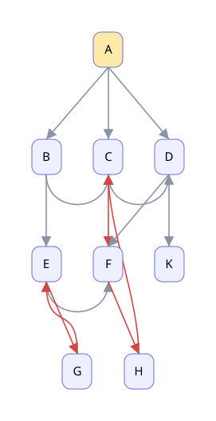

# depviz — визуализация графа зависимостей Cargo

Практическая работа №2 по дисциплине «Конфигурационное управление», вариант 4.
Выполнила: Быстрова Анна Сергеевна, УНБО-04-25.

## Общее описание

`depviz` — консольное приложение (CLI) на Python 3, которое строит граф
зависимостей пакета менеджера пакетов Cargo (язык Rust) и рисует его
на языке диаграмм Mermaid. Используется только стандартная библиотека
Python: готовые менеджеры пакетов и библиотеки для получения зависимостей
не используются.

Что умеет программа:

1. Читать настройки из конфигурационного файла INI и проверять их (этап 1).
2. Получать прямые зависимости заданной версии пакета из репозитория
   crates.io (этап 2).
3. Строить полный граф зависимостей обходом в ширину (BFS) без рекурсии,
   с ограничением глубины и обработкой циклов; работать с тестовым
   репозиторием из файла (этап 3).
4. Выводить обратные зависимости — пакеты, которые зависят от заданного
   (этап 4).
5. Формировать текст диаграммы Mermaid и показывать изображение графа
   (этап 5).

## Настройки (файл INI)

Все параметры задаются в секции `[depviz]`:

| Параметр | Описание | Пример |
|---|---|---|
| `package` | имя анализируемого пакета | `serde_json` |
| `repository` | URL репозитория или путь к файлу тестового репозитория | `https://index.crates.io` |
| `test_mode` | режим работы с тестовым репозиторием (`true` / `false`) | `false` |
| `version` | версия пакета (`MAJOR.MINOR.PATCH`) | `1.0.128` |
| `max_depth` | максимальная глубина анализа (целое ≥ 1) | `3` |
| `mode` | необязательный: `graph` (по умолчанию), `reverse`, `mermaid` | `mermaid` |
| `output_dir` | необязательный: папка для файлов диаграммы (по умолчанию `out`) | `out` |

Пример (`configs/serde_json.ini`):

```ini
[depviz]
package = serde_json
repository = https://index.crates.io
test_mode = false
version = 1.0.128
max_depth = 3
```

Относительный путь к тестовому репозиторию считается от папки, где лежит
конфигурационный файл.

### Обработка ошибок

При любой ошибке выводится сообщение `error: ...` и программа завершается
с кодом 1:

- нет файла, неверный синтаксис INI, нет секции `[depviz]`;
- неизвестный параметр, пропущенный или пустой параметр;
- имя пакета с недопустимыми символами (в тестовом режиме — только `A-Z`);
- `repository` не URL (`http://` / `https://`) или файл тестового
  репозитория не найден;
- `test_mode` не `true` / `false`;
- версия не в формате `MAJOR.MINOR.PATCH`;
- `max_depth` не число или меньше 1;
- неизвестный `mode`, `mode = reverse` без тестового репозитория;
- пакета или версии нет в репозитории, репозиторий недоступен;
- ошибка формата файла тестового репозитория (с номером строки),
  корневого пакета нет в тестовом репозитории.

## Как это работает

### Откуда берутся зависимости (этап 2)

Источник данных — индекс реестра Cargo `https://index.crates.io`.
Для каждого пакета в индексе есть текстовый файл, где каждая строка — JSON
с описанием одной версии и её зависимостей. Путь к файлу зависит от длины
имени: `1/a`, `2/ab`, `3/a/abc`, `se/rd/serde`. Файл скачивается модулем
`urllib`, строки разбираются модулем `json`.

Учитываются зависимости видов `normal` и `build`. Зависимости `dev`
(нужны только для тестов самого пакета) и `optional` (включаются только
через features) пропускаются.

### Граф и выбор версий (этап 3)

Граф строится обходом в ширину (BFS) без рекурсии (`graph.build_graph`):
очередь `collections.deque`, словарь глубин служит множеством посещённых
вершин. Каждая вершина раскрывается один раз, поэтому циклические
зависимости не приводят к зацикливанию. Вершины на глубине `max_depth`
не раскрываются (помечаются `... (max depth reached)`).

Для зависимости в индексе указана не версия, а требование (`^1.0`,
`~0.3`, `>=1, <2`). Как и Cargo, программа выбирает **старшую
невыдернутую (not yanked) версию**, подходящую под требование
(`semver.py`, `RegistrySource.resolve`). Вершина графа — пара
«имя версия».

Циклы ищутся обходом в глубину на явном стеке (`graph.find_cycles`):
ребро в вершину, которая сейчас лежит на пути от корня, замыкает цикл.

### Тестовый режим

При `test_mode = true` в `repository` указывается путь к файлу описания
графа. Пакеты называются большими латинскими буквами, формат строки —
`ПАКЕТ: ЗАВИСИМОСТИ`, `#` — комментарий:

```
# tests/repos/cycle.txt
A: B
B: C
C: A D
D:
```

Тестовые репозитории в `tests/repos`:

| Файл | Случай |
|---|---|
| `simple.txt` | общая зависимость (D нужна и B, и C) |
| `chain.txt` | длинная цепочка — проверка `max_depth` |
| `cycle.txt` | цикл A → B → C → A |
| `self.txt` | пакет зависит сам от себя |
| `complex.txt` | два цикла и неописанный лист K |
| `bad_format.txt`, `bad_name.txt` | ошибки формата |

### Обратные зависимости (этап 4)

При `mode = reverse` выводятся пакеты, которые зависят от заданного
(напрямую и транзитивно). Используется тот же BFS (`build_graph`), но
вместо функции «зависимости пакета» ему передаётся функция «кто зависит
от пакета» (`FileSource.reverse_source`), построенная разворотом всех
рёбер тестового репозитория (`graph.reverse_edges`). Ограничение
`max_depth` и обработка циклов работают так же.

Режим поддерживается для тестового репозитория: индекс crates.io хранит
только прямые зависимости каждого пакета, и чтобы найти обратные,
пришлось бы скачать весь реестр (более 150 тысяч пакетов).

### Визуализация (этап 5)

При `mode = mermaid` программа:

1. формирует текст диаграммы на языке Mermaid (`mermaid.to_mermaid`)
   и выводит его на экран;
2. сама рисует картинку графа в файл `out/<пакет>.svg` (`svg.to_svg`,
   `svg.save_svg`) — без интернета и сторонних библиотек; файл открывается
   прямо в VS Code или в браузере;
3. сохраняет текст Mermaid в `out/<пакет>.mmd` и HTML-страницу
   `out/<пакет>.html` (`mermaid.save`) и открывает её в браузере модулем
   `webbrowser` (`mermaid.show`) — там рисует библиотека Mermaid (нужен
   интернет).

В SVG пакеты стоят по уровням (уровень = глубина из BFS), стрелки циклов
красные, корень жёлтый, обрезанные по глубине пакеты — пунктиром.

### Изображения для трёх пакетов

**thiserror 1.0.64**



**serde_json 1.0.128**



**regex 1.10.6**



**Тестовый репозиторий complex (два цикла — красные стрелки)**



Корневой пакет выделен жёлтым, вершины, обрезанные по глубине, —
пунктиром.

## Сравнение со штатным инструментом `cargo tree`

Для сравнения создан пустой проект Cargo с одной зависимостью
(`serde_json = "=1.0.128"` и т. д.) и выполнена команда
`cargo tree -e normal,build`. Версии — на 06.11.2026.

**thiserror 1.0.64** — почти полное совпадение:

```
depviz                                   cargo tree
thiserror 1.0.64                         thiserror v1.0.64
└ thiserror-impl 1.0.64                  └── thiserror-impl v1.0.64
  ├ proc-macro2 1.0.107                      ├── proc-macro2 v1.0.107
  │ └ unicode-ident 1.0.27                   │   └── unicode-ident v1.0.27
  ├ quote 1.0.47                             ├── quote v1.0.47
  └ syn 2.0.119                              └── syn v2.0.119
    ├ proc-macro2, unicode-ident                 ├── proc-macro2, unicode-ident
    └ (нет quote)                                └── quote v1.0.47
```

**serde_json 1.0.128** — у depviz лишняя ветка `serde_core → serde_derive`
с потомками:

```
cargo tree
serde_json v1.0.128
├── itoa v1.0.18
├── memchr v2.8.3
├── ryu v1.0.23
└── serde v1.0.229
    └── serde_core v1.0.229
```

**regex 1.10.6** — у depviz нет `aho-corasick` и `memchr`:

```
cargo tree
regex v1.10.6
├── aho-corasick v1.1.5
│   └── memchr v2.8.3
├── memchr v2.8.3
├── regex-automata v0.4.18
│   ├── aho-corasick v1.1.5 (*)
│   ├── memchr v2.8.3
│   └── regex-syntax v0.8.11
└── regex-syntax v0.8.11
```

### Причины расхождений

1. **Features и необязательные зависимости.** depviz пропускает все
   `optional`-зависимости. Cargo включает часть из них через features:
   features по умолчанию (`default`) самого пакета и features, которые
   запросил пакет-родитель. Так у `regex` зависимости `aho-corasick`
   и `memchr` необязательные, но включены feature `default`; у `syn`
   необязательная `quote` включена feature `printing`. Чтобы повторить
   это, пришлось бы реализовать весь механизм features Cargo.
2. **Зависимости для конкретной платформы.** В индексе у зависимости
   может быть поле `target` (например, `cfg(windows)`). depviz учитывает
   зависимости для всех платформ, а `cargo tree` — только для текущей.
   У `serde_core` зависимость `serde_derive` записана с условием
   `cfg(any())`, которое никогда не выполняется (так авторы синхронизируют
   версии пакетов), поэтому Cargo её не показывает.
3. **Версии совпадают**: оба инструмента выбирают старшую подходящую
   версию. Если в проекте есть `Cargo.lock`, Cargo берёт версии из него,
   и тогда они могут отличаться.
4. **Вид вывода:** `cargo tree` печатает дерево и повторяет общие
   зависимости, помечая `(*)`; depviz выводит граф — каждый пакет один раз.

## Функции

| Модуль | Функция | Назначение |
|---|---|---|
| `config.py` | `load_config` | прочитать и проверить конфигурацию |
| `config.py` | `read_section` | прочитать секцию `[depviz]` |
| `config.py` | `parse_bool`, `parse_depth` | преобразовать `test_mode`, `max_depth` |
| `config.py` | `check_package`, `check_repository`, `check_version`, `check_mode` | проверить значения |
| `cargo.py` | `index_path` | путь к файлу пакета в индексе |
| `cargo.py` | `download` | скачать файл по URL (`urllib`) |
| `cargo.py` | `CargoRegistry.releases` | все версии пакета (с кэшем) |
| `cargo.py` | `CargoRegistry.release` | описание заданной версии |
| `cargo.py` | `CargoRegistry.direct_dependencies` | прямые зависимости версии |
| `semver.py` | `parse_version`, `parse_requirement`, `matches` | версии и требования Cargo |
| `sources.py` | `FileSource` | тестовый репозиторий из файла |
| `sources.py` | `FileSource.reverse_source` | «кто зависит от пакета» |
| `sources.py` | `RegistrySource.resolve` | выбрать версию под требование |
| `sources.py` | `make_source` | выбрать источник по `test_mode` |
| `graph.py` | `build_graph` | BFS без рекурсии с ограничением глубины |
| `graph.py` | `find_cycles` | найти циклы |
| `graph.py` | `reverse_edges` | развернуть рёбра графа |
| `mermaid.py` | `to_mermaid` | текст диаграммы Mermaid |
| `mermaid.py` | `save`, `show` | сохранить и открыть изображение |
| `svg.py` | `layout` | расставить пакеты по уровням BFS |
| `svg.py` | `to_svg`, `save_svg` | нарисовать граф в файл SVG |
| `__main__.py` | `print_graph`, `print_reverse`, `print_cycles` | вывод на экран |
| `__main__.py` | `run`, `main` | запуск по конфигурации, коды выхода |

## Сборка и запуск

Нужен только Python 3.8+. Устанавливать ничего не нужно.

```sh
./run.sh configs/serde_json.ini      # запуск с конфигурацией
./tests/sh/stage1.sh                 # ошибки конфигурации (этап 1)
./tests/sh/stage2.sh                 # прямые зависимости и ошибки (этап 2)
./tests/sh/stage3.sh                 # граф, глубина, циклы (этап 3)
./tests/sh/stage4.sh                 # обратные зависимости (этап 4)
./tests/sh/stage5.sh                 # Mermaid и изображения (этап 5)
PYTHONPATH=src python3 -m unittest discover -s tests -t .   # тесты
```

## Примеры использования

```
$ ./run.sh configs/test_cycle.ini
dependency graph of A (max_depth = 10)
packages: 4, edges: 4
  [0] A -> B
  [1] B -> C
  [2] C -> A, D
  [3] D
cycles: 1
  A -> B -> C -> A

$ ./run.sh configs/reverse_simple_d.ini
reverse dependencies of D (max_depth = 10)
packages: 4, edges: 4
  [0] D <- B, C
  [1] B <- A
  [1] C <- A
  [2] A
packages depending on D: B, C, A
cycles: none

$ ./run.sh configs/mermaid_thiserror.ini
graph TD
    n0["thiserror 1.0.64"]
    n1["thiserror-impl 1.0.64"]
    n2["proc-macro2 1.0.107"]
    n3["quote 1.0.47"]
    n4["syn 2.0.119"]
    n5["unicode-ident 1.0.27"]
    n0 --> n1
    n1 --> n2
    n1 --> n3
    n1 --> n4
    n2 --> n5
    n3 --> n2
    n4 --> n2
    n4 --> n5
    classDef root fill:#ffe9a8,stroke:#b7791f
    classDef cut stroke-dasharray:5 5
    class n0 root
picture: out/thiserror_1.0.64.svg
image: out/thiserror_1.0.64.html
cycles: none

$ ./run.sh tests/configs/bad_depth_zero.ini
error: max_depth: must be >= 1, got 0
```
